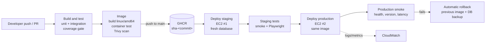

# TaskTracker build and release pipeline

Owner: Ali (Person B). AWS host setup: Jinxi (Person C). Test suites: Hamza (Person D). Application: Aqeel (Person A).

This file explains how a commit on `main` becomes a running production release, what each team member has to configure, and how to recover from a bad release.

## 1. Pipeline at a glance



| Job | Runs on | What it does | Stops the release when |
| --- | --- | --- | --- |
| Build and test | every push and PR | restore, Release build, `*Tests.csproj` suites with Coverlet, ReportGenerator summary | build fails, a test fails, coverage < 80% line or < 70% branch |
| Image | every push and PR | builds the Docker image for `linux/amd64`, starts it, checks `/health`, `/`, `/Tasks`, `/version` and the non-root user, runs the smoke script (form create and delete, latency), and checks that a task survives container replacement; Trivy scan (report only); pushes to GHCR on `main` | the image does not start or a check fails |
| Deploy staging | push to `main` | runs `deploy/deploy.sh` on the staging EC2 host; staging starts from an empty, freshly migrated database | the new container is not healthy or reports the wrong commit (host rolls back) |
| Staging tests | after staging deploy | `scripts/smoke.sh` and any `*E2E*`/`*Staging*`/`*Playwright*` test projects against `STAGING_URL` | any check or test fails |
| Deploy production | after staging tests pass | promotes the same `sha-<commit>` image; no manual approval | host health gate fails (host rolls back) |
| Production smoke | same job | health, version, pages, one labelled task created and deleted, 100-request latency sample (p95 ≤ 500 ms) | any check fails, then the job redeploys the previous release |
| Recovery redeploy | manual (`workflow_dispatch`) | puts an earlier `sha-<commit>` image back into production | n/a |

Every image carries its commit in three places: the tag `sha-<full sha>` (plus `sha-<short>` and `main`), the OCI label `org.opencontainers.image.revision`, and the `APP_VERSION` variable that `/version` reports.

## 2. Files

| File | Purpose |
| --- | --- |
| `Dockerfile` | Two-stage build. .NET 10 SDK publishes the app; the ASP.NET runtime image runs it as the non-root `app` user on port 8080. SQLite lives in the `/app/data` volume. |
| `.dockerignore` | Keeps `bin/`, `obj/`, local `.db` files, `.env` files and keys out of the build context. |
| `docker-compose.yml` | Local container run with a named volume. |
| `.github/workflows/ci-cd.yml` | The pipeline. |
| `.github/actions/deploy/` | Sends `deploy/deploy.sh` to a host through SSM or SSH. |
| `deploy/deploy.sh` | Runs on the EC2 host: pull, stop old container, back up the database, start new container, health and version gate, roll back on failure. |
| `scripts/smoke.sh` | External checks and latency sample; writes CSV/JSON evidence. |

## 3. Running the container locally

Docker Desktop on an Apple Silicon Mac builds an arm64 image by default, which is fine for local use. CI builds `linux/amd64` for EC2.

```bash
cd SWE40006-TaskTracker
GIT_SHA=$(git rev-parse HEAD) docker compose up --build -d
open http://localhost:8080
curl http://localhost:8080/health          # Healthy
curl http://localhost:8080/version         # {"commit":"<sha>", ...}
bash scripts/smoke.sh http://localhost:8080 $(git rev-parse HEAD) 20

# Persistence check: create a task in the browser, then replace the container
docker compose down && docker compose up -d
# the task is still there

docker compose down -v                     # removes the container AND the data volume
```

To build exactly what CI builds: `docker buildx build --platform linux/amd64 --build-arg GIT_SHA=$(git rev-parse HEAD) -t tasktracker:amd64 .`

## 4. One-time configuration

### 4.1 GitHub (repository admin: Aqeel, or Ali with admin rights)

Settings → Environments → create `staging` and `production`. Do not add required reviewers to `production`; the brief specifies automatic promotion.

Settings → Secrets and variables → Actions:

| Name | Kind | Scope | Value |
| --- | --- | --- | --- |
| `DEPLOY_METHOD` | variable | repository | `ssm` (default) or `ssh` |
| `AWS_REGION` | variable | repository | e.g. `ap-southeast-2` |
| `STAGING_URL` | variable | repository | `http://<staging public DNS or IP>` |
| `PRODUCTION_URL` | variable | repository | `http://<production public DNS or IP>` |
| `LOG_GROUP_PREFIX` | variable | repository | optional, e.g. `/tasktracker`; container logs go to `/tasktracker/staging` and `/tasktracker/production` |
| `AWS_ROLE_ARN` | secret | repository | role GitHub assumes through OIDC (ssm method) |
| `AWS_AUTH` | variable | repository | set to `keys` only if you use access keys instead of OIDC |
| `AWS_ACCESS_KEY_ID`, `AWS_SECRET_ACCESS_KEY` | secret | repository | only when `AWS_AUTH=keys` |
| `EC2_INSTANCE_ID` | variable | each environment | staging / production instance ID (ssm method) |
| `EC2_HOST`, `EC2_SSH_USER` | variable | each environment | host and user (ssh method) |
| `EC2_SSH_KEY` | secret | each environment | private key (ssh method) |

Branch protection on `main` (Settings → Branches): require a pull request and require the "Build and test" and "Build, check and publish image" checks to pass.

GHCR: the deploy job passes its short-lived `GITHUB_TOKEN` to the host for one `docker pull`, then deletes the login, so a private package works. After the first push, open the package (your profile → Packages → `swe40006-tasktracker`) → Package settings → "Manage Actions access" and confirm this repository has access.

### 4.2 AWS (Jinxi)

Each EC2 host (staging and production, Amazon Linux 2023, x86_64):

```bash
sudo dnf install -y docker
sudo systemctl enable --now docker
# SSM agent is preinstalled on Amazon Linux 2023
```

Instance IAM role (instance profile): `AmazonSSMManagedInstanceCore` and `CloudWatchAgentServerPolicy`. The second also lets Docker's `awslogs` driver write container logs.

Security group: inbound TCP 80 from `0.0.0.0/0` (the runner and the demo browser must reach it; the app holds only fictional data). No inbound SSH is needed with the SSM method. With the SSH method, port 22 must be reachable from GitHub-hosted runners.

GitHub OIDC role for the pipeline (ssm method):

1. IAM → Identity providers → add `token.actions.githubusercontent.com`, audience `sts.amazonaws.com`.
2. Create a role with this trust policy:

```json
{
  "Version": "2012-10-17",
  "Statement": [{
    "Effect": "Allow",
    "Principal": { "Federated": "arn:aws:iam::<ACCOUNT_ID>:oidc-provider/token.actions.githubusercontent.com" },
    "Action": "sts:AssumeRoleWithWebIdentity",
    "Condition": {
      "StringEquals": { "token.actions.githubusercontent.com:aud": "sts.amazonaws.com" },
      "StringLike": { "token.actions.githubusercontent.com:sub": "repo:Aqeel-Kareem-cyber/SWE40006-TaskTracker:*" }
    }
  }]
}
```

3. Attach this permissions policy (least privilege: run commands only on the two instances):

```json
{
  "Version": "2012-10-17",
  "Statement": [
    {
      "Effect": "Allow",
      "Action": "ssm:SendCommand",
      "Resource": [
        "arn:aws:ec2:<REGION>:<ACCOUNT_ID>:instance/<STAGING_INSTANCE_ID>",
        "arn:aws:ec2:<REGION>:<ACCOUNT_ID>:instance/<PRODUCTION_INSTANCE_ID>",
        "arn:aws:ssm:<REGION>::document/AWS-RunShellScript"
      ]
    },
    { "Effect": "Allow", "Action": ["ssm:GetCommandInvocation", "ssm:ListCommandInvocations"], "Resource": "*" }
  ]
}
```

4. Put the role ARN in the `AWS_ROLE_ARN` secret.

Check from a laptop that SSM can reach a host before running the pipeline:

```bash
aws ssm describe-instance-information --query 'InstanceInformationList[].{id:InstanceId,ping:PingStatus}'
```

## 5. What happens on the host

`deploy/deploy.sh` runs as root on the EC2 instance:

1. `docker pull` the new image.
2. Stop the running `tasktracker` container and rename it `tasktracker-previous`.
3. Copy `tasktracker.db` from the `tasktracker-data` volume to `/var/lib/tasktracker-deploy/backups/` (last 10 kept). The container is stopped, so the copy is consistent.
4. Staging only: delete the database so EF Core migrations rebuild it.
5. Start the new container on the same volume, port 80 → 8080, `--restart unless-stopped`.
6. Wait up to 90 s for `/health` = `Healthy`, then check `/version` reports the expected commit and `/` and `/Tasks` return 200.
7. Success: remove `tasktracker-previous` and old images (three kept). Failure: remove the new container, restore the database backup, restart the previous container, exit 1.

Restoring the database is a separate step from restarting the old image. A release whose migration changed the schema would otherwise leave the old code running against a newer schema.

## 6. Recovery

| Situation | What happens / what to do |
| --- | --- |
| New release fails its health or version check on the host | Automatic. The previous container and database are restored before the job fails. |
| Release passes the host check but fails the external production smoke test | Automatic. The job reads the previous commit from `/version` before deploying and redeploys `sha-<previous>`. |
| A bad release is found later | Actions → CI/CD → Run workflow → enter the last good full commit SHA in `redeploy_sha`. Or revert the commit on `main` and let the pipeline run. |
| Data needs restoring | On the host: `sudo docker stop tasktracker`, copy a file from `/var/lib/tasktracker-deploy/backups/` over `$(docker volume inspect -f '{{.Mountpoint}}' tasktracker-data)/tasktracker.db`, `sudo docker start tasktracker`. |
| Run the deploy by hand | Copy `deploy/deploy.sh` to the host, then `sudo IMAGE=ghcr.io/aqeel-kareem-cyber/swe40006-tasktracker:sha-<sha> EXPECTED_SHA=<sha> APP_ENV=Production bash deploy.sh` |

## 7. Agreements with the rest of the group

Hamza (tests):
- Unit and in-process integration projects: name them `*Tests.csproj` (for example `tests/TaskTracker.Tests/TaskTracker.Tests.csproj`) and reference `coverlet.msbuild`. CI runs them before the image is built.
- Staging and browser projects: put `E2E`, `Staging` or `Playwright` in the project name. CI runs them after the staging deploy with `TASKTRACKER_BASE_URL`, `EXPECTED_COMMIT` and `E2E_RUN_PREFIX` set. Browser installation is handled by the workflow.
- Write Playwright traces to a `playwright-traces/` folder so they are uploaded.

Aqeel (application): the `feature/cicd` branch makes two small changes to `Program.cs` that the pipeline depends on. Please review them in the pull request.
- `/version` returns `{"commit": "<APP_VERSION>", "environment": "<name>"}`. `APP_VERSION` is set to the commit SHA when the image is built.
- `/health` now includes a `database` check that queries the Tasks table (package `Microsoft.Extensions.Diagnostics.HealthChecks.EntityFrameworkCore` 10.0.13), so `Healthy` means the SQLite file and schema are usable.
- The container sets `ASPNETCORE_HTTP_PORTS=8080` and `ConnectionStrings__DefaultConnection`; please keep reading the connection string from configuration.

Jinxi (AWS): section 4.2, plus the CloudWatch agent for memory and disk metrics and the CPU alarm.

## 8. Evidence to capture for the Week 12 report

- Workflow run graph for a full release (Actions → run → summary page).
- Job summary showing coverage, image digest, smoke results and the "commit to verified production" time.
- `production-results-<sha>` artifact (`deployment-record.json`, `latency.csv`).
- A seeded-fault run that stops at the expected gate, with production still on the previous commit.
- A rollback: the log lines starting `ROLLBACK:` and `/version` showing the previous commit.
- GHCR package page listing `sha-` tags.
- Data surviving a deployment: a task created before release N still present after release N+1.
- For metrics: `gh run list --workflow ci-cd.yml --branch main --limit 50 --json conclusion,createdAt,updatedAt,headSha > runs.json`

## 9. Known limitations

- HTTP only. No TLS certificate is configured, which is acceptable for fictional demonstration data but not for real use.
- The app has no authentication. Anyone who can reach port 80 can create and delete tasks.
- SQLite and a single container per host: a deployment causes a few seconds of downtime while the container is swapped.
- The Trivy scan reports vulnerabilities but does not fail the build.
- Migrations run at application start-up, which suits one instance per environment only.
